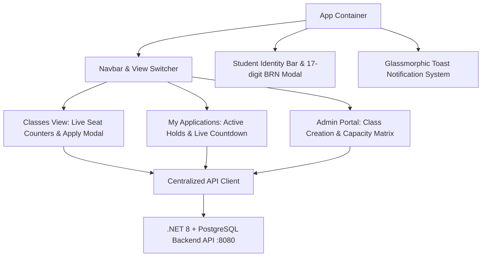

# EduAdmit • School Admission & Seat Allocation System (Frontend)

[](https://react.dev/)
[](https://www.typescriptlang.org/)
[](https://vite.dev/)
[](https://tailwindcss.com/)
[](LICENSE)

An enterprise-grade, concurrency-safe SaaS frontend client for the **School Admission System**, built for high-demand, first-come first-served admission workflows. Developed with strict compliance to **OnnoRokom Projukti Limited** recruitment assignment specifications.

---

## 🌟 Key Features & Architectural Highlights

- **17-Digit National BRN Identity Switcher (`X-Student-Id`):**
  - Instant toggle between test applicant profiles or custom 17-digit Birth Registration Numbers.
  - Automatically injected into HTTP headers via centralized API interceptors.
  - Client-side pre-flight regex validation: `^\d{17}$`.
- **First-Come First-Served & Concurrency-Safe Seat Reservations:**
  - Backed by PostgreSQL row-level locks (`SELECT ... FOR UPDATE`) in the backend.
  - Guaranteed zero over-allocation: `heldSeats + confirmedSeats <= totalSeats`.
  - Comprehensive handling of HTTP `409 Conflict`, `400 Bad Request`, and `403 Forbidden` with toast feedback.
- **Dynamic 10-Minute Hold Expiry & Live Countdown Timer:**
  - Real-time countdown widget tracking `expiresAt` with color-coded urgency triggers (< 2 minutes).
  - Background auto-polling (6s interval) to instantly synchronize seat releases when holds expire.
- **Idempotent Admission Confirmation:**
  - Secure modal dialogs for confirming admissions (fee payment simulation) and releasing seats.
  - Repeated confirmation calls succeed idempotently without double-counting seats.
- **School Authority Administration Portal:**
  - Real-time monitoring of all active classes, seat statistics, and capacity progress bars.
  - Instant class creation form with interactive quick presets.
- **Manual Hash-Based Routing Architecture:**
  - 100% flicker-free client-side routing without reliance on external server fallback configuration.
  - Native browser back/forward button synchronization via `window.location.hash`.

---

## 🏛️ Application Architecture & Design System



---

## 📂 Modular Clean Architecture

```text
src/
├── assets/                 # SVGs, icons, and static brand assets
├── components/
│   ├── navigation/         # Navbar, view switcher, StudentIdentityBar
│   └── ui/                 # Reusable atomic UI (Button, Modal, Input, Badge, CountdownTimer)
├── constants/              # Demo student credentials and static datasets
├── context/                # Context providers (ToastProvider, StudentProvider)
├── features/               # Feature-based domain modules
│   ├── classes/            # ClassCard, ClassList, ClassSeatProgressBar
│   ├── holds/              # MyApplications, HoldDetailCard, ConfirmModal
│   └── admin/              # AdminPortal, ClassCreationForm, CapacityTable
├── hooks/                  # Custom isolated hooks (useStudent, useToast)
├── services/               # Centralized API service with X-Student-Id injection
├── types/                  # Strict TypeScript interfaces matching backend DTOs
└── utils/                  # 17-digit BRN validators, datetime & countdown formatters
```

---

## 🔌 API Contract Compliance

The frontend client connects to `http://localhost:8080` (configured via `VITE_API_BASE_URL`):

| # | HTTP Method | Endpoint | Required Header | Description |
|---|---|---|---|---|
| 1 | `GET` | `/classes` | - | Fetches all active admission classes with live seat statistics |
| 2 | `GET` | `/classes/{classId}` | - | Gets real-time seat status for an individual class |
| 3 | `POST` | `/classes` | - | Creates a new class (`{ name, totalSeats }`) |
| 4 | `POST` | `/classes/{classId}/holds` | `X-Student-Id` | Reserves an admission seat (10-minute hold window) |
| 5 | `GET` | `/holds/{holdId}` | - | Fetches hold status (`HELD`, `CONFIRMED`, `EXPIRED`, `CANCELLED`) |
| 6 | `POST` | `/holds/{holdId}/confirm` | `X-Student-Id` | Confirms seat admission permanently (idempotent) |
| 7 | `DELETE` | `/holds/{holdId}` | `X-Student-Id` | Cancels hold and releases seat immediately |
| 8 | `GET` | `/me/holds` | `X-Student-Id` | Lists all applications belonging to the current applicant |

---

## 🚀 Getting Started

### Prerequisites
- **Node.js**: v20+ or v22+
- **Backend API**: Ensure the .NET 8 backend is running on `http://localhost:8080` (via Docker Compose or `dotnet run`).

### Installation & Execution

1. **Clone the repository and navigate into the frontend folder:**
   ```bash
   cd schoole-admission-system-frontend
   ```

2. **Verify Environment Variables:**
   Inspect `.env` (default points to backend on port 8080):
   ```env
   VITE_API_BASE_URL=http://localhost:8080
   ```

3. **Install Dependencies:**
   ```bash
   npm install
   ```

4. **Start Development Server:**
   ```bash
   npm run dev
   ```
   Open `http://localhost:5173` in your browser.

5. **Typecheck & Production Build:**
   ```bash
   npm run build
   ```

6. **Run ESLint Suite:**
   ```bash
   npm run lint
   ```

---

## 🎨 Color Palette & UI Philosophy

- **Slate (`slate-900` / `slate-950`):** Modern SaaS dark mode canvas ensuring low eye fatigue and high contrast.
- **Indigo (`indigo-500` / `indigo-600`):** Primary brand accent signifying educational authority, trust, and focus.
- **Emerald (`emerald-500`):** Positive status indicator for confirmed admissions, available seats, and secure operations.
- **Amber (`amber-500`):** Real-time pulse indicator for active 10-minute seat holds and countdown timers.
- **Rose (`rose-500`):** Concurrency alerts, class capacity limits, and cancellation warnings.
